## ✦ The story so far

I'm a full stack developer working across the **MERN stack**, **AI-powered applications**, and **Android with Kotlin**. I build practical, finished software rather than throwaway demos.

Right now I'm going deeper into full-stack architecture and AI-powered apps, with the goal of building software that real people use every day.

> **Learn → Build → Improve → Ship**

## ✦ Account at a glance

<!--FACTS:START-->
| Detail | Value |
| :-- | :-- |
| Name | Amlan Shanker |
| Username | [@AmlanShanker](https://github.com/AmlanShanker) |
| Location | Bengaluru |
| Website | https://amlanshanker.github.io/Portfolio/ |
| Joined GitHub | May 2024 |
| Public repositories | 28 |
| Followers | 1 |
| Following | 0 |
| Starred repositories | 9 |
| Stars earned | 8 |
| Contributions (12 months) | 332 |
<!--FACTS:END-->

_The table and the cards above refresh automatically from the GitHub API._

## ✦ Contribution dunes

## ✦ What I'm working on

| | |
| :-- | :-- |
| 🌐 **Full-stack applications** | MongoDB, Express, React, and Node.js |
| 🤖 **AI-powered systems** | SaaS tools built around generative features |
| 📱 **Android development** | Kotlin and XML in Android Studio |
| 🏗️ **Software architecture** | Structuring larger, more maintainable systems |

**Workflow:** `idea → design → develop → test → improve → ship`

## ✦ Pinned projects

<b>GenZenius</b> · AI-powered SaaS · JavaScript

 

A SaaS platform where users can access premium AI services: **Article Generation**, **Blog Title Suggestions**, **Image Generation**, **Background Removal**, **Object Removal**, and **Resume** tools.

[View repository →](https://github.com/AmlanShanker/GenZenius-AI-powered-SAAS)

<b>Finance Dashboard</b> · MERN · JavaScript

 

A finance dashboard created with the MERN stack: MongoDB, Express, React, and Node.js.

[View repository →](https://github.com/AmlanShanker/MERN-Stack-Finance-Dashboard-App)

<b>Expense Tracker</b> · MERN · JavaScript

 

An expense tracker created with the MERN stack.

[View repository →](https://github.com/AmlanShanker/Expense-Tracker-MERN-Stack)

<b>Social Media App</b> · MERN · JavaScript

 

A dynamic social media application created with the MERN stack.

[View repository →](https://github.com/AmlanShanker/Social-Media-MERN-Stack)

<b>Notes App</b> · Android · Kotlin

 

An Android notes app created in Android Studio using Kotlin and XML.

[View repository →](https://github.com/AmlanShanker/NotesApp)

<b>Movie Ticket Booking</b> · Web · HTML

 

A responsive, interactive web application that simplifies booking movie tickets. Users can register, log in, browse available movies, calculate ticket costs, and book tickets.

[View repository →](https://github.com/AmlanShanker/Movie-ticket-booking-system)

## ✦ Every repository

<!--REPOS:START-->
| Repository | Description | Language | ★ | Forks | Last push |
| :-- | :-- | :-- | :-: | :-: | :-- |
| [**AmlanShanker**](https://github.com/AmlanShanker/AmlanShanker) | — | Python | 0 | 0 | Nov 2026 |
| [**Campus-Pulse-Smart-Crowd-Prediction**](https://github.com/AmlanShanker/Campus-Pulse-Smart-Crowd-Prediction) | — | Python | 0 | 0 | Nov 2026 |
| [**CINESCOPE-Movies-Entertainment-Intelligence-Platform**](https://github.com/AmlanShanker/CINESCOPE-Movies-Entertainment-Intelligence-Platform) | — | Python | 0 | 0 | Nov 2026 |
| [**SaathiCare_Hackathon**](https://github.com/AmlanShanker/SaathiCare_Hackathon) | — | JavaScript | 0 | 0 | Nov 2026 |
| [**Portfolio**](https://github.com/AmlanShanker/Portfolio) | A cinematic, Dune-inspired portfolio showcasing my projects, skills, and journey as a full-stack developer. 🏜️ | HTML | 1 | 0 | Nov 2026 |
| [**Autonomous-Universal-Research-Agent---AURA**](https://github.com/AmlanShanker/Autonomous-Universal-Research-Agent---AURA) | — | Python | 0 | 0 | Oct 2026 |
| [**FSD-Lab-8**](https://github.com/AmlanShanker/FSD-Lab-8) | — | JavaScript | 0 | 0 | Sep 2026 |
| [**Social-Media-MERN-Stack**](https://github.com/AmlanShanker/Social-Media-MERN-Stack) | A Social Media dynamic application created using MERN Stack | JavaScript | 1 | 0 | Sep 2026 |
| [**DSA**](https://github.com/AmlanShanker/DSA) | — | Java | 0 | 0 | Sep 2026 |
| [**Campus_Connect**](https://github.com/AmlanShanker/Campus_Connect) | — | JavaScript | 0 | 0 | Aug 2026 |
| [**FSD_SSR_CSR_NEXT.JS**](https://github.com/AmlanShanker/FSD_SSR_CSR_NEXT.JS) | — | TypeScript | 0 | 0 | Aug 2026 |
| [**FSD-CIA-Student_Project_Tracker**](https://github.com/AmlanShanker/FSD-CIA-Student_Project_Tracker) | — | JavaScript | 0 | 0 | Aug 2026 |
| [**FSD-Lab-7**](https://github.com/AmlanShanker/FSD-Lab-7) | — | JavaScript | 0 | 0 | Aug 2026 |
| [**ScreenHive**](https://github.com/AmlanShanker/ScreenHive) | — | JavaScript | 0 | 0 | Jul 2026 |
| [**React-Project**](https://github.com/AmlanShanker/React-Project) | — | JavaScript | 0 | 0 | Jul 2026 |
| [**CRUD-Express**](https://github.com/AmlanShanker/CRUD-Express) | — | JavaScript | 0 | 0 | Jul 2026 |
| [**Movie-ticket-booking-system**](https://github.com/AmlanShanker/Movie-ticket-booking-system) | A responsive and interactive web application that simplifies the movie ticket booking process. Users can register, log in, browse available movies, calculate ticket costs, and book tickets through an intuitive and mobile-friendly interface. | HTML | 1 | 0 | Jul 2026 |
| [**GenZenius-AI-powered-SAAS**](https://github.com/AmlanShanker/GenZenius-AI-powered-SAAS) | GenZenius is an AI-powered SaaS platform where users can access premium services such as Article Generation, Blog Title Suggestions, Image Generation, Background Removal, Object Removal, and Resume Review. | JavaScript | 1 | 0 | Jul 2026 |
| [**Spice-Symphony**](https://github.com/AmlanShanker/Spice-Symphony) | The main aim of this website is to enhance the fine diner experience by introducing a preview of useful information, engaging content and accessible online services.  | PHP | 1 | 0 | Jul 2026 |
| [**NotesApp**](https://github.com/AmlanShanker/NotesApp) | A Notes App created in Android Studio using Kotlin and XML | Kotlin | 1 | 0 | Jul 2026 |
| [**AI-MediBot**](https://github.com/AmlanShanker/AI-MediBot) | — | Python | 0 | 0 | Oct 2025 |
| [**basic-MCU-multiverse-html**](https://github.com/AmlanShanker/basic-MCU-multiverse-html) | — | HTML | 0 | 0 | Jun 2025 |
| [**Expense-Tracker-MERN-Stack**](https://github.com/AmlanShanker/Expense-Tracker-MERN-Stack) | An Expense Tracker Created Using MERN Stack | JavaScript | 1 | 0 | May 2025 |
| [**MERN-Stack-Finance-Dashboard-App**](https://github.com/AmlanShanker/MERN-Stack-Finance-Dashboard-App) | A Finance Dashboard Created Using MERN Stack | JavaScript | 1 | 0 | May 2025 |
| [**To-do-Next-JS**](https://github.com/AmlanShanker/To-do-Next-JS) | This project is a simple To-Do list application built with Next.js, MongoDB, and Tailwind CSS.  | JavaScript | 0 | 0 | Apr 2025 |
| [**Electricity-Billing-System**](https://github.com/AmlanShanker/Electricity-Billing-System) | This project introduces an ELECTRICITY BILLING SYSTEM built with Java, linked to a Database Management System (DBMS) using JDBC. It features interfaces designed for two main users: administrators and customers. | Java | 0 | 0 | Feb 2025 |
| [**AmlanShanker.github.io**](https://github.com/AmlanShanker/AmlanShanker.github.io) | — | HTML | 0 | 0 | May 2024 |

Forked repositories (1)

- [coding-interview-university](https://github.com/AmlanShanker/coding-interview-university) — A complete computer science study plan to become a software engineer.

<!--REPOS:END-->

## ✦ The tools

| Layer | Technologies |
| :-- | :-- |
| Frontend | HTML, CSS, JavaScript, React |
| Backend | Node.js, Express, Java, Python |
| Database | MongoDB |
| Mobile | Kotlin, Android |
| Tools | Git, GitHub, VS Code, Figma |

## ✦ Let's build something

Got a project, a role, or an idea? Find me here:

- 💼 [LinkedIn](https://www.linkedin.com/in/amlan-shanker/)
- 🧩 [LeetCode](https://leetcode.com/u/tiPha4TJ2s/)
- 🎧 [Spotify](https://open.spotify.com/user/31sn7gyx4ndathbfr543f274hs3a?si=d11d384ff5874dbe)
- 🐙 [GitHub](https://github.com/AmlanShanker)

 

Stats, the contribution graph, and the repository table are regenerated by `scripts/update_profile.py` through a scheduled GitHub Action.
