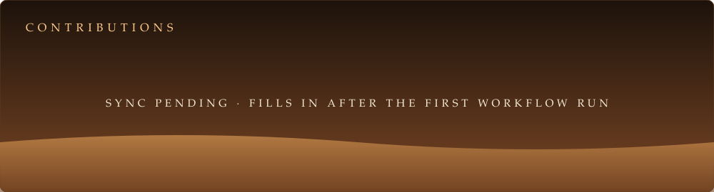

## ✦ The story so far

I'm a full stack developer working across the **MERN stack**, **AI-powered applications**, and **Android with Kotlin**. I build practical, finished software rather than throwaway demos.

Right now I'm going deeper into full-stack architecture and AI-powered apps, with the goal of building software that real people use every day.

> **Learn → Build → Improve → Ship**

## ✦ Account at a glance

<!--FACTS:START-->
| Detail | Value |
| :-- | :-- |
| Name | Amlan Shanker |
| Username | [@AmlanShanker](https://github.com/AmlanShanker) |
| Public repositories | 25 |
| Followers | 1 |
| Following | 0 |
| Starred repositories | 8 |
| Stars earned | 6 |
<!--FACTS:END-->

_The table and the cards above refresh automatically from the GitHub API._

## ✦ Contribution dunes

## ✦ What I'm working on

| | |
| :-- | :-- |
| 🌐 **Full-stack applications** | MongoDB, Express, React, and Node.js |
| 🤖 **AI-powered systems** | SaaS tools built around generative features |
| 📱 **Android development** | Kotlin and XML in Android Studio |
| 🏗️ **Software architecture** | Structuring larger, more maintainable systems |

**Workflow:** `idea → design → develop → test → improve → ship`

## ✦ Pinned projects

<b>GenZenius</b> · AI-powered SaaS · JavaScript

 

A SaaS platform where users can access premium AI services: **Article Generation**, **Blog Title Suggestions**, **Image Generation**, **Background Removal**, **Object Removal**, and **Resume** tools.

[View repository →](https://github.com/AmlanShanker/GenZenius-AI-powered-SAAS)

<b>Finance Dashboard</b> · MERN · JavaScript

 

A finance dashboard created with the MERN stack: MongoDB, Express, React, and Node.js.

[View repository →](https://github.com/AmlanShanker/MERN-Stack-Finance-Dashboard-App)

<b>Expense Tracker</b> · MERN · JavaScript

 

An expense tracker created with the MERN stack.

[View repository →](https://github.com/AmlanShanker/Expense-Tracker-MERN-Stack)

<b>Social Media App</b> · MERN · JavaScript

 

A dynamic social media application created with the MERN stack.

[View repository →](https://github.com/AmlanShanker/Social-Media-MERN-Stack)

<b>Notes App</b> · Android · Kotlin

 

An Android notes app created in Android Studio using Kotlin and XML.

[View repository →](https://github.com/AmlanShanker/NotesApp)

<b>Movie Ticket Booking</b> · Web · HTML

 

A responsive, interactive web application that simplifies booking movie tickets. Users can register, log in, browse available movies, calculate ticket costs, and book tickets.

[View repository →](https://github.com/AmlanShanker/Movie-ticket-booking-system)

## ✦ Every repository

<!--REPOS:START-->
| Repository | Description | Language | ★ | Forks | Last push |
| :-- | :-- | :-- | :-: | :-: | :-- |
| [**GenZenius-AI-powered-SAAS**](https://github.com/AmlanShanker/GenZenius-AI-powered-SAAS) | GenZenius is an AI-powered SaaS platform with Article Generation, Blog Title Suggestions, Image Generation, Background Removal, Object Removal, and Resume tools. | JavaScript | 1 | 0 | — |
| [**MERN-Stack-Finance-Dashboard-App**](https://github.com/AmlanShanker/MERN-Stack-Finance-Dashboard-App) | A Finance Dashboard Created Using MERN Stack | JavaScript | 1 | 0 | — |
| [**Expense-Tracker-MERN-Stack**](https://github.com/AmlanShanker/Expense-Tracker-MERN-Stack) | An Expense Tracker Created Using MERN Stack | JavaScript | 1 | 0 | — |
| [**Social-Media-MERN-Stack**](https://github.com/AmlanShanker/Social-Media-MERN-Stack) | A Social Media dynamic application created using MERN Stack | JavaScript | 1 | 0 | — |
| [**NotesApp**](https://github.com/AmlanShanker/NotesApp) | A Notes App created in Android Studio using Kotlin and XML | Kotlin | 1 | 0 | — |
| [**Movie-ticket-booking-system**](https://github.com/AmlanShanker/Movie-ticket-booking-system) | A responsive and interactive web application that simplifies the movie ticket booking process. | HTML | 1 | 0 | — |

_Showing the 6 most recently pushed of 25 public repositories._
<!--REPOS:END-->

## ✦ The tools

| Layer | Technologies |
| :-- | :-- |
| Frontend | HTML, CSS, JavaScript, React |
| Backend | Node.js, Express, Java, Python |
| Database | MongoDB |
| Mobile | Kotlin, Android |
| Tools | Git, GitHub, VS Code, Figma |

## ✦ Let's build something

Got a project, a role, or an idea? Find me here:

- 💼 [LinkedIn](https://www.linkedin.com/in/amlan-shanker/)
- 🧩 [LeetCode](https://leetcode.com/u/tiPha4TJ2s/)
- 🎧 [Spotify](https://open.spotify.com/user/31sn7gyx4ndathbfr543f274hs3a?si=d11d384ff5874dbe)
- 🐙 [GitHub](https://github.com/AmlanShanker)

 

Stats, the contribution graph, and the repository table are regenerated by `scripts/update_profile.py` through a scheduled GitHub Action.
