 

 

## ✦ The story so far

I'm a full stack developer working across the **MERN stack**, **AI-powered applications**, and **Android with Kotlin**. I like products that are practical and finished, not just demos.

Right now I'm going deeper into full-stack architecture and AI-powered apps, aiming to build software that real people use every day.

> **Learn → Build → Improve → Ship**

 

## ✦ Currently

- 🌐 Building full-stack applications
- 🤖 Working on AI-powered systems
- 📱 Developing Android apps
- 🏗️ Studying software architecture

 

## ✦ Selected work

| Project | What it is | Stack |
| :-- | :-- | :-- |
| [**GenZenius**](https://github.com/AmlanShanker/GenZenius-AI-powered-SAAS) | AI-powered SaaS platform: article generation, blog title suggestions, image generation, background removal, object removal, and resume tools | `JavaScript` `AI` `SaaS` |
| [**Finance Dashboard**](https://github.com/AmlanShanker/MERN-Stack-Finance-Dashboard-App) | A finance dashboard built with MongoDB, Express, React, and Node.js | `MERN` |
| [**Expense Tracker**](https://github.com/AmlanShanker/Expense-Tracker-MERN-Stack) | An expense tracker for logging and reviewing spending | `MERN` |
| [**Social Media App**](https://github.com/AmlanShanker/Social-Media-MERN-Stack) | A dynamic social media application | `MERN` |
| [**Notes App**](https://github.com/AmlanShanker/NotesApp) | An Android notes app built in Android Studio | `Kotlin` `XML` |
| [**Movie Ticket Booking**](https://github.com/AmlanShanker/Movie-ticket-booking-system) | A responsive web app to register, log in, browse movies, calculate ticket costs, and book tickets | `HTML` |

 

## ✦ The tools

 

## ✦ Let's build something

Got a project, a role, or an idea? Reach me on [LinkedIn](https://www.linkedin.com/in/amlan-shanker/) or open an issue on any of my repos.

 

